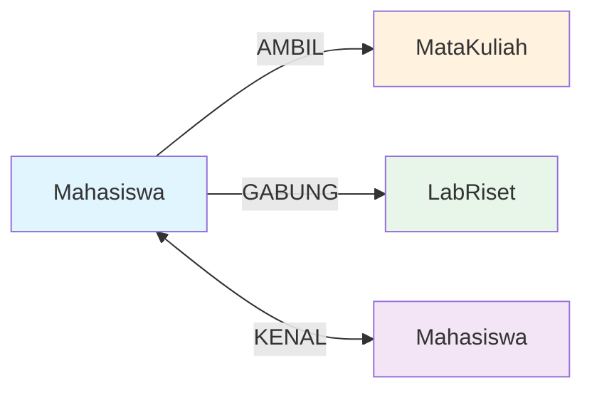

# 📊 Neo4j Knowledge Graph: Sistem Akademik Mahasiswa

> **README Presentation** - Dokumentasi kode Cypher untuk membangun graph pengetahuan mahasiswa, mata kuliah, dan lab riset dengan analisis Graph Data Science

---

## 🗂️ Daftar Isi

1. [Overview](#-overview)
2. [Struktur Graph](#-struktur-graph)
3. [Step-by-Step Code Explanation](#-step-by-step-code-explanation)
4. [Graph Algorithms](#-graph-algorithms)
5. [Cara Menjalankan](#-cara-menjalankan)
6. [Contoh Query Analisis](#-contoh-query-analisis)

---

## 🎯 Overview

Kode Cypher ini membangun **graph pengetahuan akademik** yang mencakup:

| Komponen | Jumlah | Deskripsi |
|----------|--------|-----------|
| `:MataKuliah` | 5 | Node mata kuliah dengan ID dan nama |
| `:LabRiset` | 5 | Node laboratorium riset |
| `:Mahasiswa` | 30 | Node mahasiswa dengan NRP dan nama |
| `:AMBIL` | Variabel | Relasi mahasiswa mengambil MK + nilai |
| `:GABUNG` | 30 | Relasi mahasiswa bergabung ke lab |
| `:KENAL` | Dinamis | Relasi sosial berdasarkan kesamaan |

🔧 **Tech Stack**: Neo4j + Graph Data Science Library (GDS)

---

## 🔗 Struktur Graph



### 🔹 Nodes & Properties

```cypher
// 🎓 Mata Kuliah
:MataKuliah {
  id: String,    // 'ETI', 'GRAF', dll
  nama: String   // 'Etika teknologi informasi'
}

// 🔬 Lab Riset
:LabRiset {
  id: String,    // 'ADDI', 'IKTI', dll
  nama: String   // 'ADDI Lab'
}

// 👨‍🎓 Mahasiswa
:Mahasiswa {
  id: String,    // 'NRP1', 'NRP2', ...
  nama: String   // 'Mahasiswa 1'
}
```

### 🔹 Relationships & Properties

| Relasi | Direction | Properties | Deskripsi |
|--------|-----------|------------|-----------|
| `:AMBIL` | Mahasiswa → MataKuliah | `nilai: Float` | Mahasiswa mengambil MK dengan nilai |
| `:GABUNG` | Mahasiswa → LabRiset | `tahun_masuk: Int` | Mahasiswa bergabung ke lab |
| `:KENAL` | Mahasiswa ↔ Mahasiswa | `sharekenal: Int` | Skor kedekatan berdasarkan kesamaan |

---

## 📝 Step-by-Step Code Explanation

### 1️⃣ Membuat 5 Mata Kuliah

```cypher
CREATE 
  (mk1:MataKuliah {id: 'ETI', nama: 'Etika teknologi informasi'}),
  (mk2:MataKuliah {id: 'GRAF', nama: 'Graf Pengetahuan'}),
  (mk3:MataKuliah {id: 'PBA', nama: 'Pengolahan Bahasa Alami'}),
  (mk4:MataKuliah {id: 'SE', nama: 'Sistem Enterprise'}),
  (mk5:MataKuliah {id: 'RO', nama: 'Riset Operasional'});
```

✅ **Output**: 5 node `:MataKuliah` dengan ID unik dan nama lengkap.

---

### 2️⃣ Membuat 5 Lab Riset

```cypher
CREATE 
  (lab1:LabRiset {id: 'ADDI', nama: 'ADDI Lab'}),
  (lab2:LabRiset {id: 'IKTI', nama: 'IKTI Lab'}),
  (lab3:LabRiset {id: 'MSI', nama: 'MSI Lab'}),
  (lab4:LabRiset {id: 'SE', nama: 'SE Lab'}),
  (lab5:LabRiset {id: 'RDIB', nama: 'RDIB Lab'});
```

✅ **Output**: 5 node `:LabRiset` sebagai wadah riset mahasiswa.

---

### 3️⃣ Membuat 30 Mahasiswa

```cypher
UNWIND range(1, 30) AS i
CREATE (m:Mahasiswa {id: 'NRP' + toString(i), nama: 'Mahasiswa ' + i});
```

🔄 **Logika**: 
- `range(1,30)` menghasilkan angka 1-30
- Setiap iterasi membuat mahasiswa dengan NRP `NRP1` sampai `NRP30`

✅ **Output**: 30 node `:Mahasiswa` dengan ID berurutan.

---

### 4️⃣ Relasi `:AMBIL` (Mahasiswa → MataKuliah)

#### 📌  Variabel 2-4 MK (Deterministik)
```cypher
UNWIND range(1, 30) AS i
WITH i, 'NRP' + toString(i) AS mId,
     CASE 
       WHEN i % 5 = 0 THEN 4    // Prioritas tertinggi
       WHEN i % 3 = 0 THEN 3    // Prioritas menengah
       ELSE 2                   // Default
     END AS jumlah_mk,
     ['ETI','GRAF','PBA','SE','RO'] AS all_mk
UNWIND range(0, jumlah_mk - 1) AS idx
WITH mId, all_mk[(i + idx) % 5] AS mk_id, i, idx
MATCH (m:Mahasiswa {id: mId})
MATCH (mk:MataKuliah {id: mk_id})
MERGE (m)-[:AMBIL {nilai: 3.0 + ((i + idx) % 2)}]->(mk);
```

🧠 **Strategi**:
- Mahasiswa dengan `i % 5 = 0` mengambil **4 MK**
- Mahasiswa dengan `i % 3 = 0` mengambil **3 MK**
- Sisanya mengambil **2 MK**
- Penugasan MK menggunakan modulo untuk menghindari duplikat

> 💡 **Tips**: Gunakan `MATCH...MERGE` untuk menghindari relasi duplikat saat regenerasi data.

---

### 5️⃣ Relasi `:GABUNG` (Mahasiswa → LabRiset)

```cypher
UNWIND range(1, 30) AS i
WITH 'NRP' + toString(i) AS mId,
     ['ADDI','SE','MSI','RDIB','IKTI'][((i-1) % 5)] AS lab
MATCH (m:Mahasiswa {id: mId}), (l:LabRiset {id: lab})
MERGE (m)-[:GABUNG {tahun_masuk: 2025}]->(l);
```

🔄 **Logika**: Distribusi merata ke 5 lab menggunakan `(i-1) % 5`.

✅ **Output**: Setiap mahasiswa tergabung di 1 lab dengan `tahun_masuk: 2025`.

---

### 6️⃣ Membangun Relasi Sosial `:KENAL`

```cypher
MATCH (m1:Mahasiswa)-[:GABUNG]->(lab:LabRiset)<-[:GABUNG]-(m2:Mahasiswa),
      (m1)-[:AMBIL]->(mk:MataKuliah)<-[:AMBIL]-(m2)
WHERE elementId(m1) < elementId(m2)
WITH m1, m2, 
     count(DISTINCT lab) AS sharedLabs, 
     count(DISTINCT mk) AS sharedCourses
WHERE sharedLabs > 0 AND sharedCourses > 0
MERGE (m1)-[r:KENAL]-(m2)
SET r.sharekenal = sharedCourses + sharedLabs;
```

🤝 **Kriteria "Kenal"**:
1. Minimal 1 lab yang sama ✅
2. Minimal 1 mata kuliah yang sama ✅
3. Skor `sharekenal` = jumlah MK + lab yang sama

🔒 **Pencegahan Duplikat**: `elementId(m1) < elementId(m2)` memastikan relasi tidak terduplikasi dan tidak ada self-loop.

---

## 🧮 Graph Algorithms (GDS)

### 🔹 Step 1: Project Graph ke Memory

```cypher
MATCH (source:Mahasiswa)-[r:KENAL]->(target:Mahasiswa)
RETURN gds.graph.project(
  'MahasiswaGraph',
  source,
  target,
  { relationshipProperties: r { .sharekenal } },
  { KENAL: {orientation: 'UNDIRECTED'}}
)
```

📦 **Konfigurasi**:
- Graph name: `'MahasiswaGraph'`
- Relationship: `:KENAL` (undirected)
- Property: `sharekenal` untuk bobot edge

---

### 🔹 Step 2: Node Embedding dengan `fastRP`

```cypher
CALL gds.fastRP.mutate(
  'MahasiswaGraph',
  {
    embeddingDimension: 8,
    mutateProperty: 'fastrp-embedding'
  }
)
YIELD nodePropertiesWritten
```

🧠 **Apa itu fastRP?**
- Algoritma *feature propagation* untuk membuat vektor representasi node
- `embeddingDimension: 8` → setiap mahasiswa direpresentasikan sebagai vektor 8-dimensi
- Hasil disimpan di property `fastrp-embedding`

---

### 🔹 Step 3: Similarity dengan K-Nearest Neighbors (KNN)

```cypher
CALL gds.knn.stream('MahasiswaGraph', {
    topK: 1,
    nodeProperties: ['fastrp-embedding'],
    randomSeed: 1337,
    concurrency: 1,
    sampleRate: 1.0,
    deltaThreshold: 0.0
})
YIELD node1, node2, similarity
RETURN gds.util.asNode(node1).nama AS Person1, 
       gds.util.asNode(node2).nama AS Person2, 
       similarity
ORDER BY similarity DESCENDING, Person1, Person2
```

🎯 **Tujuan**: Mencari 1 mahasiswa paling mirip untuk setiap node berdasarkan embedding.

⚙️ **Parameter Deterministik**:
| Parameter | Nilai | Fungsi |
|-----------|-------|---------|
| `randomSeed` | 1337 | Hasil konsisten tiap eksekusi |
| `concurrency` | 1 | Single-threaded untuk reproduktibilitas |
| `sampleRate` | 1.0 | Gunakan 100% data |

---

### 🔹 Step 4: Clustering dengan K-Means

```cypher
CALL gds.kmeans.stream('MahasiswaGraph', {
  nodeProperty: 'fastrp-embedding',
  k: 3,
  randomSeed: 42
})
YIELD nodeId, communityId
RETURN gds.util.asNode(nodeId).nama AS nama, communityId
ORDER BY communityId, nama ASC
```

📊 **Output**: Setiap mahasiswa dikelompokkan ke dalam **3 klaster** berdasarkan kemiripan profil akademik & sosial.

🔍 **Interpretasi Klaster**:
| Cluster | Kemungkinan Karakteristik |
|---------|---------------------------|
| 0 | Mahasiswa dengan fokus mata kuliah teknis + lab tertentu |
| 1 | Mahasiswa dengan nilai tinggi + kolaborasi intensif |
| 2 | Mahasiswa dengan pola pengambilan MK acak + lab berbeda |

---

## 🚀 Cara Menjalankan

### Prasyarat
```bash
✅ Neo4j Desktop / AuraDB (versi 5.x+)
✅ Graph Data Science Library terinstall
✅ Database kosong atau siap di-reset
```

### Langkah Eksekusi
1. Buka **Neo4j Browser** atau **Bloom**
2. Copy-paste kode Cypher section-by-section
3. Jalankan dengan tombol ▶️ atau `Ctrl+Enter`
4. Monitor progress di panel hasil

### ⚠️ Catatan Penting
```cypher
// 🔁 Untuk regenerasi data, hapus dulu relasi lama:
MATCH ()-[r:AMBIL|GABUNG|KENAL]->() DELETE r;
MATCH (n:MataKuliah|LabRiset|Mahasiswa) DELETE n;

// 🧹 Bersihkan graph GDS dari memory:
CALL gds.graph.drop('MahasiswaGraph', false);
```

---

## 🔍 Contoh Query Analisis

### 📈 Distribusi Mahasiswa per Lab
```cypher
MATCH (m:Mahasiswa)-[:GABUNG]->(l:LabRiset)
RETURN l.nama AS Lab, count(m) AS Jumlah_Mahasiswa
ORDER BY Jumlah_Mahasiswa DESC;
```

### 🎯 Mata Kuliah Paling Populer
```cypher
MATCH (m:Mahasiswa)-[r:AMBIL]->(mk:MataKuliah)
RETURN mk.nama AS MataKuliah, 
       count(m) AS Peminat,
       avg(r.nilai) AS RataRataNilai
ORDER BY Peminat DESC;
```

### 👥 Temukan "Super Connector" (Mahasiswa Paling Terhubung)
```cypher
MATCH (m:Mahasiswa)-[:KENAL]-(teman)
RETURN m.nama AS Mahasiswa, 
       count(DISTINCT teman) AS Jumlah_Koneksi,
       m.sharekenal AS TotalSkorKesamaan
ORDER BY Jumlah_Koneksi DESC
LIMIT 10;
```

### 🧭 Visualisasi Klaster K-Means
```cypher
CALL gds.kmeans.stream('MahasiswaGraph', {
  nodeProperty: 'fastrp-embedding',
  k: 3,
  randomSeed: 42
})
YIELD nodeId, communityId
WITH gds.util.asNode(nodeId) AS m, communityId
RETURN m.nama AS Mahasiswa, 
       communityId AS Klaster,
       [(m)-[:GABUNG]->(l) | l.nama][0] AS Lab
ORDER BY Klaster, Mahasiswa;
```

---

## 📚 Referensi & Sumber Daya

| Sumber | Link |
|--------|------|
| 📘 Neo4j Cypher Manual | [neo4j.com/docs/cypher-manual](https://neo4j.com/docs/cypher-manual/) |
| 🔬 GDS Library Docs | [neo4j.com/docs/graph-data-science](https://neo4j.com/docs/graph-data-science/) |
| 🎓 fastRP Paper | [arxiv.org/abs/1903.07200](https://arxiv.org/abs/1903.07200) |
| 🧪 Contoh Playground | [neo4j.com sandbox blank graph data science](https://sandbox.neo4j.com/) |

---

> 💡 **Pro Tip**: Gunakan `:style` di Neo4j Browser untuk memvisualisasikan node dengan warna berbeda berdasarkan label atau property klaster!

```cypher
// Contoh styling manual di Browser
:MataKuliah {color: '#FFB74D', 'border-color': '#F57C00'}
:LabRiset {color: '#A5D6A7', 'border-color': '#388E3C'}
:Mahasiswa {color: '#90CAF9', 'border-color': '#1976D2'}
```

---

✨ **Selamat Membangun Graph!**  
Kode ini dapat dikembangkan lebih lanjut dengan:  
- Integrasi data real dari sistem akademik  
- Penambahan relasi `:MENGAJAR` untuk dosen  
- Analisis community detection (Louvain, Leiden)  
- Rekomendasi mata kuliah berbasis graph similarity  

🔖 *Dibuat dengan ❤️ untuk pembelajaran Graph Pengetahuan*
